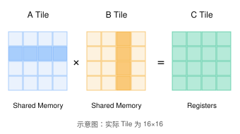

# General Matrix Multiplication (GEMM): 通用矩阵乘法（GEMM）

> **题目来源**：[LeetGPU — General Matrix Multiplication (GEMM)](https://leetgpu.com/challenges/general-matrix-multiplication-gemm) · **难度**：Medium · **语言**：CUDA C++  

## 题目描述

实现一个通用矩阵乘法（General Matrix Multiplication，GEMM）。

给定三个矩阵：

- 矩阵 `A`：维度为 `M × K`
- 矩阵 `B`：维度为 `K × N`
- 矩阵 `C`：维度为 `M × N`

以及两个标量 `alpha` 和 `beta`。

要求计算：

$$
C = \alpha(AB) + \beta C_{\text{initial}}
$$

即对每一个输出元素：

$$
C_{i,j} =
\alpha \sum_{k=0}^{K-1} A_{i,k}B_{k,j}
+\beta C_{i,j}^{\text{initial}}
$$

其中：

- `A`、`B`、`C` 的数据类型均为 FP16（half）。
- `alpha` 和 `beta` 为 FP32（float）。
- 所有矩阵均采用行优先（Row-Major）存储。
- 计算完成后，结果写回矩阵 `C`。

## 实现要求

1. 不允许调用外部矩阵计算库，但允许使用 CUDA WMMA。
2. 不允许修改 `solve` 函数签名。
3. 矩阵乘法过程使用 FP32 累加。
4. 最终结果转换为 FP16，写回 `C`。

## 示例

输入矩阵：

$$
A =
\begin{bmatrix}
1 & 2 & 3 \\
4 & 5 & 6
\end{bmatrix}
$$

$$
B =
\begin{bmatrix}
1 & 2 \\
3 & 4 \\
5 & 6
\end{bmatrix}
$$

$$
C_{\text{initial}} =
\begin{bmatrix}
1 & 1 \\
1 & 1
\end{bmatrix}
$$

给定：

```text
M = 2
N = 2
K = 3

alpha = 1.0
beta = 0.0
```

计算结果：

$$
C =
\begin{bmatrix}
22 & 28 \\
49 & 64
\end{bmatrix}
$$

## 约束条件

$$
16 \leq M,N,K \leq 4096
$$

性能评测的主要矩阵规模：

$$
M=N=K=1024
$$

## CUDA 函数接口

```cpp
#include <cuda_fp16.h>
#include <cuda_runtime.h>

// A、B、C 均为 GPU 设备指针
extern "C" void solve(
    const half* A,
    const half* B,
    half* C,
    int M,
    int N,
    int K,
    float alpha,
    float beta
) {
    // 实现 GEMM
}
```
---

## Naive: GEMM

实现思路较为简单, 每个线程各自计算最后输出矩阵C的一个元素

```cpp
#include <cuda_fp16.h>
#include <cuda_runtime.h>

__global__ void gemm(const half* A, const half* B, half* C, int M, int N, int K, float alpha, float beta) {
    int idx = blockDim.x * blockIdx.x + threadIdx.x;

    if (idx < M * N) {
        float t = 0.0;
        int row = idx / N;
        int col = idx % N;
        for (int i = 0; i < K; ++i) {
            float a = __half2float(A[row * K + i]), b = __half2float(B[i * N + col]);
            t += a * b;
        }
        float c = __half2float(C[idx]);
        C[idx] = __float2half(t * alpha + c * beta);
    }
}

// A, B, and C are device pointers
extern "C" void solve(const half* A, const half* B, half* C, int M, int N, int K, float alpha, float beta) {
    int threads = 256;
    int blocks = (M * N + threads - 1) / threads;

    gemm<<<blocks, threads>>>(A, B, C, M, N, K, alpha, beta);
    cudaDeviceSynchronize();
}
```

---

## 一级优化: Shared Memory Tiling

### 1. 核心思想
原始Kernel:
```cpp
for (int i = 0; i < K; ++i) {
    t += A[row * K + i] * B[i * N + col];
}
```
相邻的thread计算不同的col, 但是会重复读取同一行的A中的元素, 所以我们可以把矩阵划分成`16x16`的Tile:


也就是计算一个输出元素需要单独从`global memory`中读取K个A元素和K个B元素, 但是现在一个`Tile`先协同加载A, B子矩阵, 再从`shared memory`中重复使用数据

```cpp

#include <cuda_fp16.h>
#include <cuda_runtime.h>

#define TILE 16

__global__ void gemm_tiled(
    const half* A,
    const half* B,
    half* C,
    int M, int N, int K,
    float alpha, float beta
) {
    // 放在shared memory的A, B矩阵子块, 防止去global memory读取数据
    // 也就是属于同一个block中的线程都能再shared memory中看到As和Bs
    __shared__ float As[TILE][TILE];
    __shared__ float Bs[TILE][TILE];

    // 当前thread在当前block中的列下标
    int tx = threadIdx.x;
    // 当前thread在当前block中的行下标
    int ty = threadIdx.y;

    int row = blockIdx.y * TILE + ty;
    int col = blockIdx.x * TILE + tx;

    float sum = 0.0f;

    for (int k0 = 0; k0 < K; k0 += TILE) {

        // 协同加载 A Tile
        if (row < M && k0 + tx < K) {
            As[ty][tx] = __half2float(
                A[row * K + k0 + tx]
            );
        } else {
            As[ty][tx] = 0.0f;
        }

        // 协同加载 B Tile
        if (k0 + ty < K && col < N) {
            Bs[ty][tx] = __half2float(
                B[(k0 + ty) * N + col]
            );
        } else {
            Bs[ty][tx] = 0.0f;
        }

        __syncthreads();

        // 从共享内存计算部分矩阵乘积
        // 让编译器提前把循环展开
        #pragma unroll
        for (int k = 0; k < TILE; ++k) {
            sum += As[ty][k] * Bs[k][tx];
        }

        __syncthreads();
    }

    if (row < M && col < N) {
        int idx = row * N + col;

        float result = alpha * sum;

        if (beta != 0.0f) {
            result += beta * __half2float(C[idx]);
        }

        C[idx] = __float2half(result);
    }
}

extern "C" void solve(
    const half* A,
    const half* B,
    half* C,
    int M, int N, int K,
    float alpha, float beta
) {
    // kernel定义采用二维方式, 方便计算和理解
    dim3 threads(TILE, TILE);

    // kenel中x为列, y为行, z为高
    dim3 blocks(
        (N + TILE - 1) / TILE,
        (M + TILE - 1) / TILE
    );

    gemm_tiled<<<blocks, threads>>>(
        A, B, C, M, N, K, alpha, beta
    );

    cudaDeviceSynchronize();
}

```
