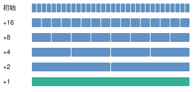

# Sparse Matrix-Vector Multiplication 稀疏矩阵-向量乘法

> **题目来源**：[Sparse Matrix-Vector Multiplication](https://leetgpu.com/challenges/sparse-matrix-vector-multiplication) · **难度**：Medium · **语言**：CUDA C++  

## 题目描述

编写一个 CUDA 程序，实现稀疏矩阵与稠密向量的乘法。

给定：

- 一个大小为 `M × N` 的稀疏矩阵 `A`。
- 一个长度为 `N` 的稠密向量 `x`。
- `nnz` 表示矩阵 `A` 中非零元素的数量。

计算输出向量：

$$
y = Ax
$$

其中：

$$
y_i = \sum_{j=0}^{N-1} A_{ij}x_j,
\quad i = 0,1,\ldots,M-1
$$

矩阵 `A` 采用 **Row-Major（行优先）** 方式存储，其中约 60%～70% 的元素为零。

## 实现要求

- 使用 CUDA 实现矩阵向量乘法。
- 不允许使用外部计算库。
- 不得修改 `solve` 函数签名。
- 将最终计算结果写入输出向量 `y`。

## 示例

**输入：**

矩阵 `A`：

$$
A =
\begin{bmatrix}
5 & 0 & 0 & 1 \\
0 & 2 & 3 & 0 \\
0 & 0 & 0 & 4
\end{bmatrix}
$$

向量 `x`：

$$
x =
\begin{bmatrix}
1 \\
2 \\
3 \\
4
\end{bmatrix}
$$

**输出：**

$$
y =
\begin{bmatrix}
9 \\
13 \\
16
\end{bmatrix}
$$

**解释：**

第一行：

$$
y_0 = 5 \times 1 + 0 \times 2 + 0 \times 3 + 1 \times 4 = 9
$$

第二行：

$$
y_1 = 0 \times 1 + 2 \times 2 + 3 \times 3 + 0 \times 4 = 13
$$

第三行：

$$
y_2 = 0 \times 1 + 0 \times 2 + 0 \times 3 + 4 \times 4 = 16
$$

因此：

$$
y = [9,13,16]
$$

## 约束条件

- `1 <= M, N <= 10000`
- 矩阵中约 60%～70% 的元素为零。
- 性能测试规模：`M = 1000`，`N = 10000`。

## CUDA 函数接口

```cpp
extern "C" void solve(
    const float* A,
    const float* x,
    float* y,
    int M,
    int N,
    int nnz
) {
    // 在此实现 CUDA Kernel
}
```

## 注意事项

- `A`、`x`、`y` 均为 GPU 设备内存指针。
- 矩阵 `A` 采用行优先存储。
- 输出向量 `y` 的长度为 `M`。
- 虽然矩阵是稀疏的，但输入 `A` 仍使用完整二维矩阵的连续内存表示，而非 CSR 或 COO 压缩稀疏格式。

---

## Naive

> Naive CUDA Kernel
> 让每个线程都计算属于自己下标的前缀和

```cpp
#include <cuda_runtime.h>

__global__ void sparse_mul(const float* A, const float* x, float* y, int M, int N, int nnz) {
    int idx = blockDim.x * blockIdx.x + threadIdx.x;

    if (idx < M) {
        float t = 0.0;
        for (int i = 0; i < N; ++i) {
            t += x[i] * A[idx * N + i];
        }
        y[idx] = t;
    }
}

// A, x, y are device pointers
extern "C" void solve(const float* A, const float* x, float* y, int M, int N, int nnz) {
    int threads = 256;
    int blocks = (M + threads - 1) / threads;

    sparse_mul<<<blocks, threads>>>(A, x, y, M, N, nnz);
    cudaDeviceSynchronize();
}


```

## 参考实现：Warp Shuffle 并行归约

一个 Warp 的 32 个线程可以读取同一行中连续的 32 个 float，形成合并访存.

```cpp

#include <cuda_runtime.h>

#define BLOCK_SIZE 256
#define WARP_SIZE 32

__global__ void sparse_mul(
    const float* __restrict__ A,
    const float* __restrict__ x,
    float* __restrict__ y,
    int M,
    int N
) {
    int row = blockIdx.x;
    int tid = threadIdx.x;
    int lane = tid & 31;
    int warp = tid >> 5;

    if (row >= M) return;

    float sum = 0.0f;
    const float* row_ptr = A + (size_t)row * N;

    // 1. 一个 Block 共同计算矩阵的一行
    for (int col = tid; col < N; col += BLOCK_SIZE) {
        sum += row_ptr[col] * x[col];
    }

    // 2. Warp 内部归约
    for (int offset = 16; offset > 0; offset >>= 1) {
        sum += __shfl_down_sync(0xffffffff, sum, offset);
    }

    // 3. 保存每个 Warp 的部分和
    __shared__ float warp_sums[BLOCK_SIZE / WARP_SIZE];

    if (lane == 0) {
        warp_sums[warp] = sum;
    }

    __syncthreads();

    // 4. 第一个 Warp 汇总所有 Warp 的结果
    if (warp == 0) {
        sum = (lane < BLOCK_SIZE / WARP_SIZE)
            ? warp_sums[lane]
            : 0.0f;

        for (int offset = 16; offset > 0; offset >>= 1) {
            sum += __shfl_down_sync(0xffffffff, sum, offset);
        }

        if (lane == 0) {
            y[row] = sum;
        }
    }
}

extern "C" void solve(
    const float* A,
    const float* x,
    float* y,
    int M,
    int N,
    int nnz
) {
    sparse_mul<<<M, BLOCK_SIZE>>>(A, x, y, M, N);
}

```

### 理解 Warp Shuffle 归约

```cpp
for (int offset = 16; offset > 0; offset >>= 1) {
    sum += __shfl_down_sync(0xffffffff, sum, offset);
}
```
