# Hymba: A Hybrid-head Architecture for Small Language Models

> Paper: Hymba: A Hybrid-head Architecture for Small Language Models  
> Authors: NVIDIA Research  
> arXiv: 2411.13676

## 1. Hymba的目标
假设模型读了一篇很长的文章，第一段写着：“小王把钥匙放进蓝色抽屉。”之后讲了很多事情，最后问：“钥匙在哪个颜色的抽屉里？”

模型需要两种能力. 一种是理解文章大意，例如“物品已经收好”；另一种是准确保留和取回“蓝色抽屉”这个细节. 只记大意，可能答不出颜色；把所有细节在所有层都完整保留，可能需要很大的缓存.

Hymba想做一个既能准确找回历史细节, 又不用为每一层保存大量历史KV的小语言模型. 它不是单纯把模型做小，也不是把 Attention 全部替换掉，而是重新分配两类序列处理机制的职责：Attention 提供高分辨率召回，SSM 提供低成本上下文概括，再用窗口注意力、KV 共享和可学习前缀共同优化.

---

## 2. 先前架构的不足
### 2.1 Transformer
Transformer: 查询的仔细, 但是历史越长成本越高
Self Attention 可以根据当前问题, 对历史位置进行内容匹配. 但是全局 Attention 需要处理大量位置之间的关系, 对于完整序列, 关系计算通常以平方倍增长. 在自回归生成的时候, KV Cache 虽然可以避免重复计算, 但是缓存依旧会随着历史长度增长.

### 2.2 Mamba/SSM
状态空间模型(SSM)以隐状态递推编码历史, Mamba选择采用选择性SSM: 根据当前输入决定怎样传播, 写入, 读取状态.
优点是, 推理的时候状态空间大小不会随着序列长度不断变大, 状态的张量形状可以保持不变, 但是要把更多历史信息压入到有限的容量状态, 精确复制, 定位或召回某些细节会变得更加困难.

### 2.3 先前的混合模型
例如 Jamba, Samba 等模型, 已经有把 Attention 和 SSM 混合起来使用的尝试.
例如 Samba 的基本模式就是: Mamba-FFN-Attention-FNN,
当前输入先经过一种处理机制, 然后再交给另一种处理机制.
本文作者认为: 第一种机制只记大意，第二种机制再接着查细节。如果第一步压缩掉了重要信息，后续处理可能需要补救.作者据此提出顺序融合可能形成信息瓶颈.

### 2.4 本文的创新设计
由于上述 `2.3` 中提到的问题, 作者决定把两类处理机制路径放入到同一个混合头模块中, 让两者接收同一份输入, 在当前层直接融合输出, 在同一层次里集合两种设计的优势.

---

## 3. Hymba的核心设计
### 3.1 记忆解释模块
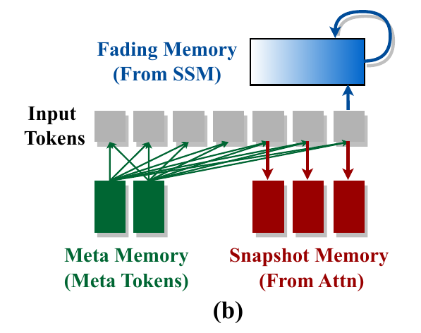
Attention 对应 Snapshot Memory , SSM 对应 Fading Memory, Meta Token 对应 Meta Memory.
Snapshot Memory 可以理解为相对精细的历史快照, Fading Memory 可以理解为持续更新, 但是可能丢失历史细节的压缩状态, Meta Memory 为作者对学习前缀的认知类比.
在钥匙例子中，Attention 更适合回看“蓝色抽屉”这一局部细节；SSM 更适合用固定状态保持已经读过的上下文. Meta Tokens 不是用来把这篇文章总结成摘要，它们是一组模型学习出来、推理时固定的前缀向量.

### 3.2 模块具体设计
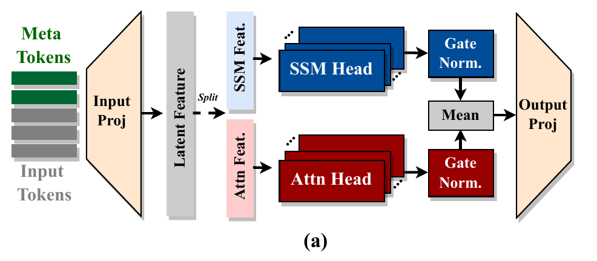
左侧是拼入 Meta Tokens 的输入；Input Proj 把输入转成各路径所需的特征；Split 分出两路；上路用 SSM 处理，下路用 Attention 处理；两路输出经过 Gate Norm；最后合并，再通过 Output Proj 回到模块输出空间.

### 3.3 同一输入的数学实现
设原始输入为 X，拼入 Meta Tokens 后为 X̃
$$
W_{\mathrm{in\_proj}}=[W^Q,W^K,W^V,W^{SSM},W^G].
$$
这一组投影分别生成 Attention 的 Q、K、V，SSM 的输入特征以及输出门 G. 可理解为同一份输入送进一个大投影，再分成几份给不同路径使用. 它们不是参数完全相同，而是拥有共同的输入来源.

---

## 4. 两种机制的融合方式
### 4.1 为什么不能单纯相加两路的输出
假设一份成绩按百分制给分，另一份按十分制给分. 两份分数都表达好坏，但数值尺度不同，直接相加会让百分制那路更显眼.

作者观察到 SSM 路径的输出幅值普遍大于 Attention 路径. 如果不处理这个差异，一路可能在融合时掩盖另一路。因此，先分别归一化，再用可学习向量调节每个通道的尺度.

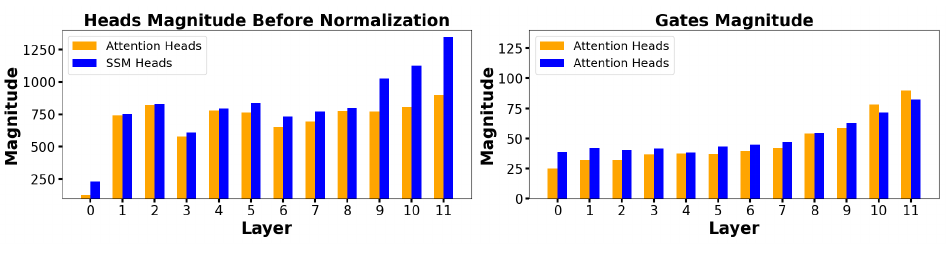
左侧为归一化之前, 两类头的输出幅度, SSM通常更大; 右图为归一化之后, 两种门的幅度层次变化.

### 4.2 融合公式
$$
Y=W_{\mathrm{out\_proj}}\left(
\beta_1\operatorname{norm}(M_{\mathrm{attn}}\widetilde X)
+\beta_2\operatorname{norm}(M_{\mathrm{ssm}}\widetilde X)
\right). \qquad
$$
norm 分别归一化两路结果；β₁、β₂ 是逐通道可学习向量，调节两路各通道的贡献；$$W_{\mathrm{out\_proj}}$$ 把融合结果投影成模块输出. 向量缩放按通道作用，可以理解为逐元素乘法和广播，而不是把 β 当成一个普通矩阵乘上去.

β₁、β₂ 不是必须和为 1 的概率，也不是根据每次输入动态二选一的路由器。不要把该模块解释为“模型每次先决定只用 Attention 或只用 SSM”. 两路都参与计算，其作用还会受输入相关的路径输出影响. 

### 4.3 为什么不使用输出结果拼接
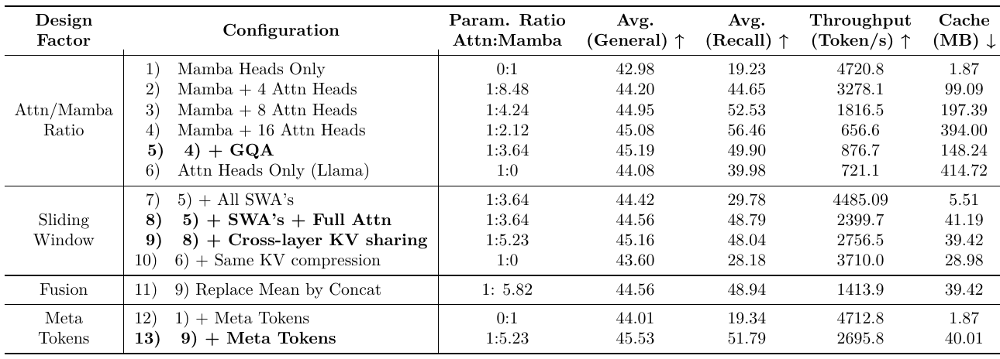
拼接同样可以把两路结果交给输出线性层，但输出线性层的输入更宽，参数和计算开销可能更大. 在图中第 9 与第 11 行的受控比较中，拼接没有体现更好的整体折中：一般任务均分由 45.16 变为 44.56，吞吐由 2756.5 降到 1413.9 token/s；召回均分略升到 48.94. 作者因此选择均值融合.

### 4.4 两路均值相加是否有用
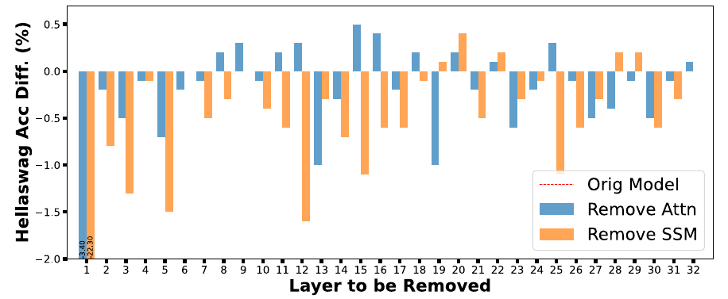
 在 HellaSwag 的 1000 个样本上，依次去掉某一层的 Attention 或 SSM 路径，观察准确率相对完整模型的变化.

实验通过将 `6.2` 公式中 β₁ 或 β₂ 置零来移除对应路径。横轴是被移除路径的层，纵轴是准确率变化。负柱表示变差；首层有些变化超出显示范围.

作者发现，SSM 首层特别重要，移除后会接近随机猜测表现；通常单层路径被移除也会影响结果。正文报告 HellaSwag 上 Attention/SSM 的平均准确率下降约 0.24/1.1 个百分点。不同层、不同任务的影响不同，这支持两类路径承担不同作用，但不是对融合参数做了输入动态路由。

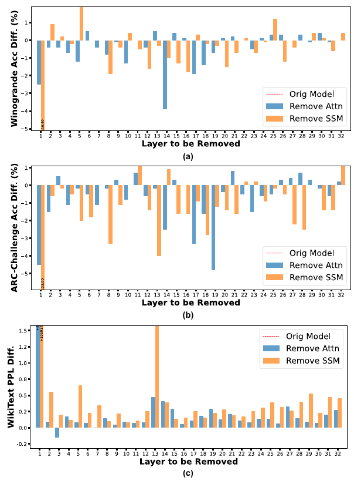
附录还展示 Winogrande、ARC-Challenge、WikiText.  前两项准确率越高越好；WikiText 用困惑度，升高表示变差.

## 5.怎么把 KV Cache 降下来
### 5.1 优化不止是并行融合
加入 Attention 后，召回能力提高了，但也重新引入 KV 缓存成本. Hymba 的后续设计就是解决这个代价：大多数层只做局部 Attention；只在少数层保留全局 Attention；多个层复用一组 K、V；配合 GQA 控制 KV 头数. 

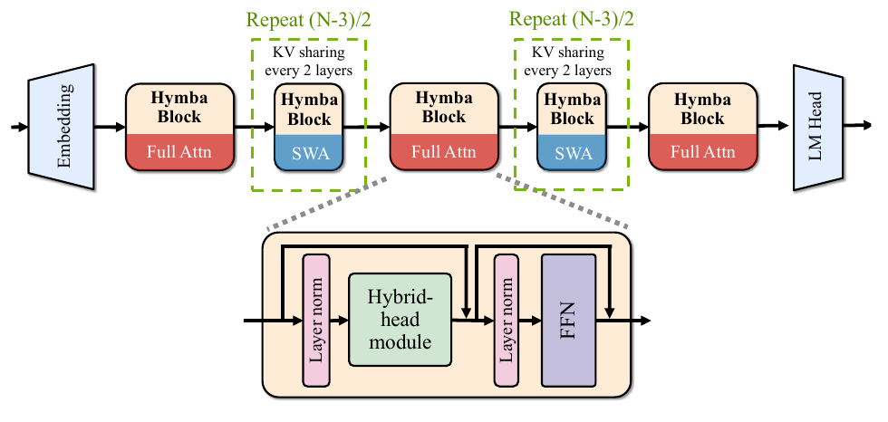
上方展示模型由多个 Hymba Block 组成，首、中、末有全局 Attention，其余主要采用 SWA，并共享部分跨层 KV；下方是具有归一化、混合头、FFN 和残差连接的基本 Block.

### 5.2 滑动窗口: 大多数层只查最近的一段
Sliding Window Attention（SWA）限制每个位置主要关注最近 w 个真实位置. 举例说，全局 Attention 像可以翻整篇文章；SWA 像只能翻最近几页. 窗口往前移动，较旧的普通位置不再保留在局部访问范围里.

Hymba 的 SWA 还保留对 Meta 前缀的访问，不能把它说成“绝对只看最近 w 个位置，最前面的所有位置都不可见”. 忽略 off-by-one 细节，其因果允许集合可教学性写成：

$$
\mathcal A(i)\approx\{\text{Meta 前缀位置}\}\cup\{j\le i:\ i-j<w\}.
$$

为什么不全部蚕蛹SWA？SSM 路径仍在递推历史上下文，让局部 Attention 不必独自承担全部全局记忆. 但这种补偿有限：测试图中第 7 行，把所有 Attention 都改为 SWA，召回均分从 49.90 掉到 29.78，说明 SSM 概括不能完全替代精细的全局检索.

### 5.3 只使用三次全局Attention
作者在第一层、中间层和最后一层保留全局 Attention. 图中第 8 行中，召回均分回到 48.79，接近全局版本的 49.90；缓存从 148.24 MB 降到 41.19 MB，吞吐由 876.7 增至 2399.7 token/s。

可以把三层全局 Attention 理解为若干次跨整篇文章的精细信息交换机会，中间大部分层用更便宜的局部处理. 不过“为什么首、中、末就是数学上最优的位置”，论文没有提供一般性证明；它是实验采用并验证的设计.

### 5.4 GQA 和跨层 KV 共享不是一回事
Grouped-Query Attention（GQA）在同一层里，让多个 Query 头共用较少的 KV 头. 跨层 KV 共享是在网络深度方向上，让多个层复用一组 K、V. 前者减少每层的 KV 头数，后者减少需要独立生成和保存 KV 的组数.

“共享 K、V”不等于“共享所有层权重”，也不等于“几个层输出完全一样”. 各层仍使用自己的隐藏表示形成 Q，并完成自己的混合路径和 FFN.

一个共享组可以按生产层/消费层理解：生产层计算 K、V 并更新对应缓存；消费层取用该组 K、V，而自身计算 Q；随后得到自己的 Attention 输出. 组内数据必须按位置、形状和因果访问范围对齐，不能简单把两个层的任意缓存地址指到一起。

论文示意强调相邻两层共享，但实际发布配置不是严格每一组都两层：已核对的 1.5B Base 配置中，全局层索引是 0、15、31，KV 共享组还包含 [16,17,18] 三层组. 复现时应以选定检查点的配置为准，而不是把示意图逐层机械照搬.

---

## 6. Meta Token 机制
### 6.1 理解 softmax 的总得分问题
softmax 权重总和为 1. 即使当前可见内容都不那么有用，也不能让所有注意力权重都同时为 0. 像必须把 100 张票全部投出去一样，总要有位置接住这些权重. 

论文观察到 BOS（序列开始符号）会吸走很多注意力，相关工作称之为 attention sink. 这里不能把所有落到 BOS 的权重都称为“毫无意义的浪费”：这是一种模型行为，论文提出的处理方式是给模型提供可学习、独立于具体输入的前缀位置.

### 6.2 Meta Token 定义
$$
\widetilde X=[R,X]=[r_1,r_2,\ldots,r_m,x_1,x_2,\ldots,x_n]. \qquad
$$
R=[r₁,…,r_m] 是一组可学习嵌入，论文采用 m=128. 这些向量在预训练时与模型参数一起学习；本文实验使用同一组前缀服务所有任务. 它们不是 128 个手写词语，也不是 tokenizer 给当前文章临时生成的摘要.

最容易出错的解释是“把整篇文章先总结成 128 个 token，然后再开始读文章”. 论文没有这么做。在因果结构下，前缀位置先于真实文章出现，本来就看不到后面的文章. 之后真实 token 可以访问前缀，并与由前缀初始化的状态交互.

### 6.3 为什么可以预计算
训练结束后，R 固定，且位于每个输入开头. 因此只处理 R 所形成的各层 KV 和 SSM 状态，可以在固定模型下预先计算，作为后续真实输入的初始缓存/状态.

这与训练完全不同. 训练中 R 和模型参数持续更新，不能永久复用一份旧缓存. 推理时也只预计算固定前缀自身的计算，不是把未知文章的全部计算提前完成.

“理论上可以离线预计算”和“每种发布接口自动在请求之间离线复用”还不是同一件事. 工程实现必须确保缓存与当前模型、数据类型、位置编码设置一致，并为不同请求正确复制/隔离可变状态.

### 6.4 前缀、窗口与状态怎样共同构成信息通路
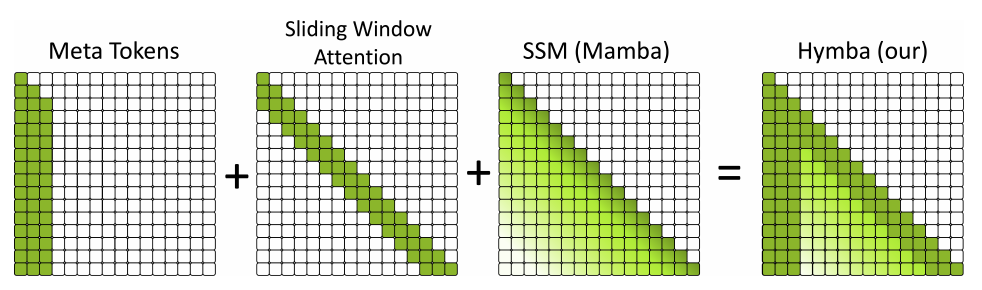
左侧竖列代表真实位置能访问 Meta 前缀；对角附近的带状区域表示 SWA 访问最近位置；SSM 则通过递推状态提供历史影响. 相加示意是“互补信息通路”的概念图，不表示实际把三个显式 n×n 注意力矩阵逐元素相加，也不表示 SSM 失去了固定状态优势.

### 6.5 两路分工与注意力重新分配
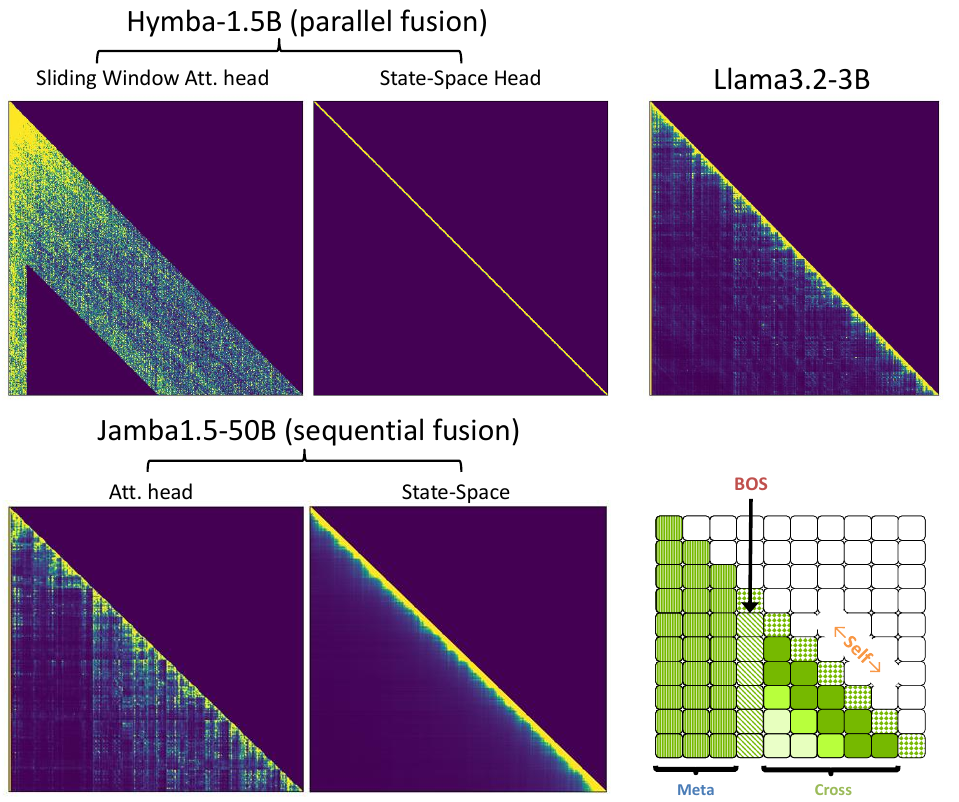
比较 Llama-3.2-3B、Jamba 和 Hymba-1.5B 在 Meta、BOS、Self、Cross 四类位置上的分布. 实验使用《雾都孤儿》第 29 章文本；SSM 的图为根据隐式影响关系计算并进行行归一化的可视化，不是它内部原生运行了 softmax Attention.

矩阵的行是当前输出位置，列是历史输入位置. Meta 是真实位置指向可学习前缀；BOS 指向开始符号；Self 指向当前自身位置；Cross 指向其他真实位置。

在展示样本中，Llama 的 BOS 约占 56%；Hymba 的窗口 Attention 约 33% 给 Meta、0% 给 BOS、67% 给其他真实 token. Hymba 的 SSM 路径 Self 比例较高，为 69%。作者据此认为两路作用更解耦：Attention 更关注其他真实位置，SSM 更侧重当前状态相关处理，Meta 承担部分前缀角色.

### 6.6 是否真的存储了世界知识
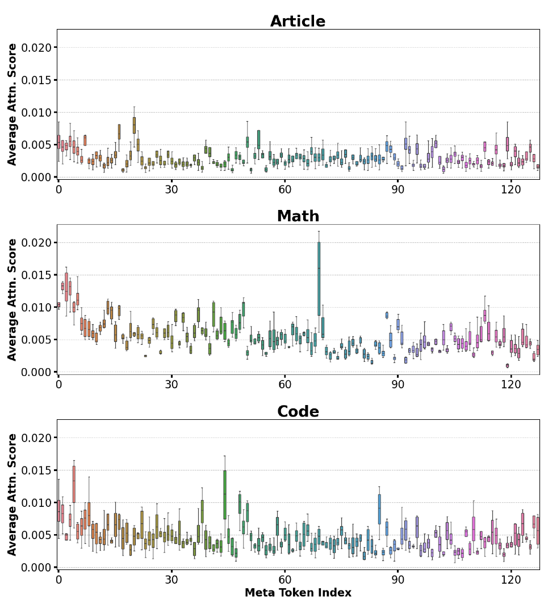
展示模型最后一层中，128 个 Meta Tokens 收到的平均注意力. Article、Math、Code 输入分别来自 SQuAD、GSM8K、GitHub-Code.

横轴是 Meta token 索引，纵轴是平均注意力响应. 不同领域输入的响应分布不同，因此作者推测不同前缀可能承载可复用的不同知识或功能. 但图本身不能把某个 token 精确命名为“数学规则 token”或“编程语法 token”，也没有证明这 128 个向量就是明确可解码的知识库.

### 6.7 注意力熵减少说明什么
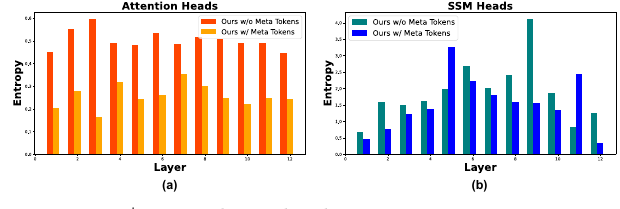
比较有无 Meta Tokens 时 Attention 与 SSM 隐式图的逐层熵

权重越分散，熵通常越高；越集中，熵越低. 作者观察到加入 Meta 后 Attention 各层熵降低，SSM 的 12 层中有 10 层降低，并结合任务分数提高，认为前缀可能帮助两路关注更小的相关位置集合.

---

## 7. 模型串讲
### 7.1 仍然为自回归的语言模型
输入文本先分词成 token，再转成嵌入 X，拼入前缀得到 X̃。经过一串 Hymba Block，最后由 LM Head 输出词表上的分数，预测下一个 token。Hymba 改了 Block 里的信息混合机制，不是放弃下一个 token 预测任务。

一个 Block 不只有两个头. 先前的模型架构图中 还包含层归一化、FFN 和残差连接. 把混合模块记为 Hybrid，可以教学性写成：
$$
Z=X+\operatorname{Hybrid}(\operatorname{Norm}_1(X)),
\qquad
X'=Z+\operatorname{FFN}(\operatorname{Norm}_2(Z)).
$$
这是结构表达，不是论文新的编号公式. 残差保留原有表示，并让更新叠加到表示上；FFN 做逐位置特征变换. 全局/局部设置主要改变 Attention 路径的可访问历史范围，SSM 路径仍存在于混合 Block 中.

### 7.2 训练、Prefill、Decode 有什么不同
训练时一次输入整段序列，模型用因果规则为不同位置形成预测，通常以真实 token 的下一词预测损失优化所有参数，包括前缀. 不同位置能采用适合整段输入的批处理和 scan；架构上有递推，不意味着训练只能在 Python 循环里逐 token 跑.

Prefill 是推理时第一次处理用户的整段提示. 它形成各层缓存和状态，局部缓存保留需要的窗口与前缀，全局缓存保留可访问历史. Decode 则每次处理新生成的一个或少量 token，利用已有 KV 和 SSM 状态继续计算.

如果已准备固定 Meta 前缀初始状态，可从它开始做真实提示的 Prefill. 为多用户服务时，各请求的可变状态不能共用同一份会被原地更新的对象，否则会出现上下文污染. 这个注意事项是根据状态式推理逻辑给出的工程解释，不是论文做过多租户服务测试的结论.

### 7.3 模型架构参数
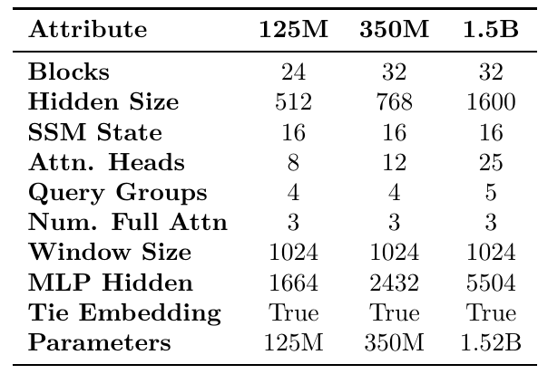

---

## 8. Hymba 的训练、长上下文和后训练流程
### 8.1 先训练 Base 再做 Instruct
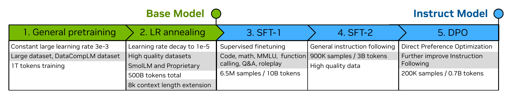
Hymba 的训练流程，先得到 Base 模型，再通过监督微调和偏好优化得到 Instruct 模型.

图中的前两阶段是语言预训练：先在大量数据上学习预测 token，再降低学习率并使用更高质量数据做退火. 图中描述为 1T 常规预训练加 500B 后续 token，共 1.5T. 最后扩展上下文长度，让模型适应更长输入.

训练长上下文不是把配置的最大长度改成 8K 就完成了. 正文 Sec. 2.5 说，最后 100B token 将序列长度从 2K 增到 8K，并调整 RoPE base. 这使模型接触更长上下文；理论上的路径覆盖和实际训练过的长度仍需区分.

### 8.2 WSD 学习率调度在做什么
Warmup-Stable-Decay（WSD）可理解为：开始逐渐升学习率，进入较高学习率的稳定训练期，最后下降学习率. 附录给出的峰值和最低学习率为 3e-3、1e-5；warmup 为总步数的 1%，decay 覆盖总步数的 20%.

学习率控制参数每次更新的幅度. 高学习率阶段学习大量模式，低学习率阶段配合高质量数据收尾. 它不是一种新架构组件，也不能把训练策略带来的效果全部归因于混合头.
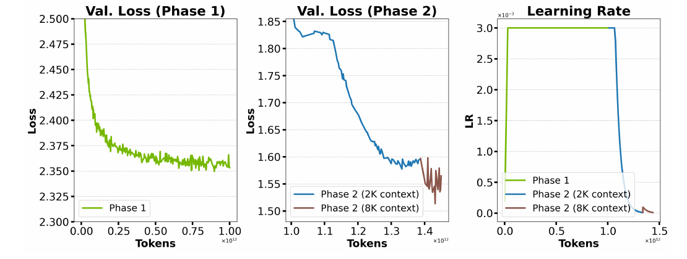

---

## 9. 设计优化结果展示
### 9.1 设计链路
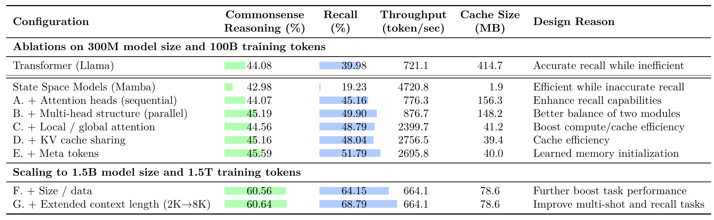
模型设计路线. 上半部分为 300M 模型、100B 训练 token 的消融；下半部分再扩模型/数据并延长上下文. 一般任务平均 8 项，召回平均 2 项；吞吐采用 A100、8K 序列、batch 128，缓存按 8K 序列与 FP16 计算.
| 结构/改动 | 一般任务均分 | 召回均分 | 吞吐 token/s | 缓存 MB |
|---|---:|---:|---:|---:|
| 纯 Transformer | 44.08 | 39.98 | 721.1 | 414.7 |
| 纯 Mamba | 42.98 | 19.23 | 4720.8 | 1.9 |
| A：顺序混合 | 44.07 | 45.16 | 776.3 | 156.3 |
| B：同层并行混合 | 45.19 | 49.90 | 876.7 | 148.2 |
| C：局部/全局 Attention | 44.56 | 48.79 | 2399.7 | 41.2 |
| D：再加跨层 KV 共享 | 45.16 | 48.04 | 2756.5 | 39.4 |
| E：再加 Meta Tokens | 45.59 | 51.79 | 2695.8 | 40.0 |

### 9.2 头数、GQA、窗口、融合、前缀的进一步选择

系统研究 Attention/Mamba 比例、GQA、窗口、KV 共享、融合和 Meta Tokens. 测试任务与 `9.1` 一致；吞吐条件为 A100、8K、batch 128，缓存按 FP16. 

增加 Attention 头可以改善召回，但缓存和计算成本上升。第 2-4 行从 4、8 到 16 个 Attention 头，召回从 44.65、52.53 到 56.46，缓存从 99.09、197.39 到 394.00 MB，吞吐逐步降低. 作者不是一直增加 Attention，而是再用 GQA、窗口和共享控制成本.

第 9 行与第 10 行尤其重要：对纯 Transformer 施加类似 KV 压缩，召回由 39.98 降到 28.18；混合模型在这一优化链中仍维持约 48 的召回. 这个对照支持“SSM 历史路径让局部化更可行”的解释。

参数比例 Attn:Mamba 是参数预算比例，不等于简单的整数头数比，也不是 β 权重的比值. 不能把表里的约 1:5.23 直接说成“每 1 个 Attention 头必须对应 5.23 个 SSM 头”.

### 9.3 最终Base模型表现
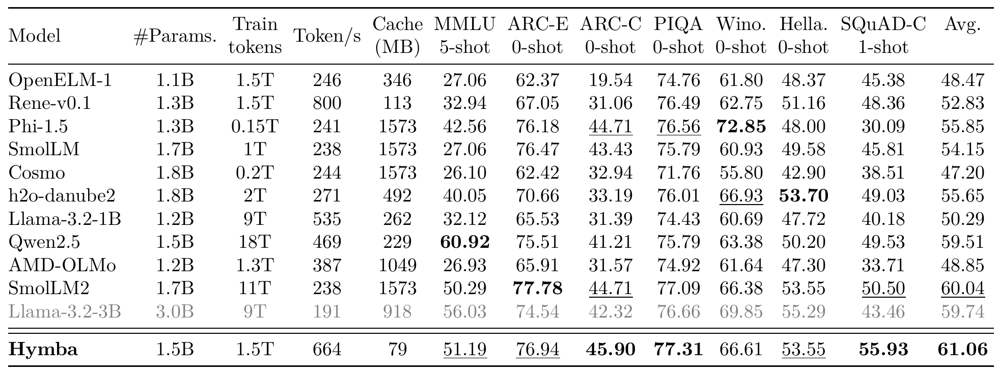
| 模型 | 参数 B | 训练 token T | 7 项平均分 | 缓存 MB | 吞吐 token/s |
|---|---:|---:|---:|---:|---:|
| Rene-v0.1 | 1.3 | 1.5 | 52.83 | 113 | 800 |
| Qwen2.5 | 1.5 | 18 | 59.51 | 229 | 469 |
| SmolLM2 | 1.7 | 11 | 60.04 | 1573 | 238 |
| Llama-3.2-3B | 3.0 | 9 | 59.74 | 918 | 191 |
| Hymba | 1.5 | 1.5 | 61.06 | 79 | 664 |

Hymba 的平均分在该表中最高，但并非每项都第一. 例如 MMLU 的 Qwen2.5 更高，Winogrande 的 Phi-1.5 更高. Rene 的吞吐 800 也高于 Hymba 的 664，所以不能说 Hymba 比所有混合模型都快.

### 9.4 同时看准确率、长度增长和吞吐
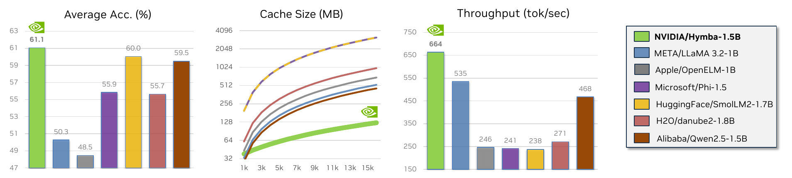
左图为 7 项平均准确率，中图为缓存随序列长度的增长，右图为吞吐. 吞吐采用 NVIDIA A100、8K 序列和名义 batch 128；遇到 OOM 的模型逐次减半 batch，测可实现吞吐.

讲左图时说“分数”，讲中图时说“随着历史变长要保存多少缓存”，讲右图时说“每秒处理多少 token”。中图的纵轴刻度不是简单线性等间隔，读图应看标注值。图中的模型子集也不包括所有 模型，因此右图最高柱不能支持“世界上所有模型中最快”.

### 9.5 效果和成本
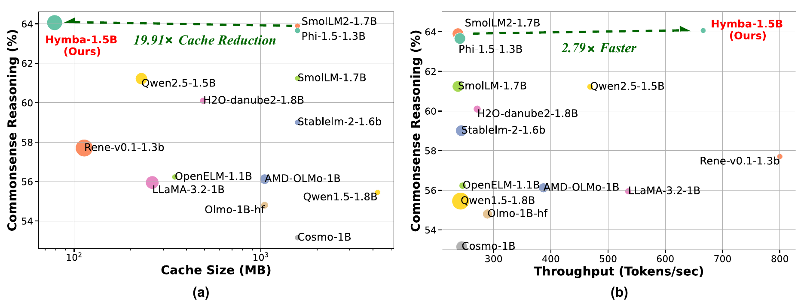
左图比较常识准确率与缓存，点大小表示吞吐；右图比较常识准确率与吞吐，点大小表示缓存. 使用 ARC-C、ARC-E、PIQA、HellaSwag、OBQA、Winogrande 的 6 项平均，而不是 Table 2 的 7 项平均.

左图越靠左上越理想：缓存少、分数高；右图越靠右上越理想：吞吐高、分数高. 图中 Hymba 位于较有利的折中区域. 点大小含义在两个面板中不同，要分别说明，不能只说“大点表示更好”.

### 9.6 结构收益
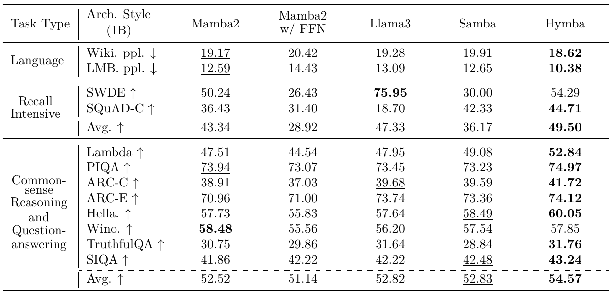
所有模型为 1B 参数，用相同配方在 SmolLM-Corpus 上从头训练 100B token，通过同一评测框架进行 zero-shot 比较.

Hymba 的召回平均分为 49.50，高于 Llama3 的 47.33 和 Samba 的 36.17；常识/问答平均分为 54.57，高于 Llama3 的 52.82 和 Samba 的 52.83. 语言建模的 WikiText/LAMBADA 困惑度更低，分别为 18.62/10.38.

但必须一起讲它的短板：SWDE 上 Llama3 为 75.95，Hymba 为 54.29；Winogrande 上 Mamba2 为 58.48，Hymba 为 57.85. Hymba 召回均分领先，主要不能掩盖两项召回任务上的差异. SWDE 是从原始 HTML 中抽取半结构化关系，SQuAD-C 是基于给定材料回答的 completion 变体.

### 9.7 长文召回解析
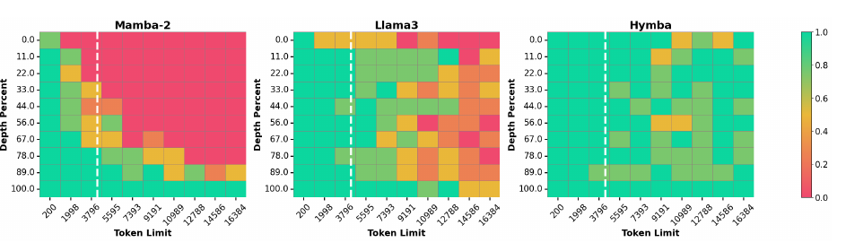
在长文不同深度插入一条信息，再问模型这条信息的内容. 白色竖线表示 4K 微调长度.

这里比较的是 1B 受控模型：先用 1K 序列预训练，再用 4K 微调，测试到 16K；不是直接把最终 1.5B 检查点搬来测试. 横轴为总长度，纵轴为插入信息的相对位置，绿色代表较好，红色代表较差.

Mamba2 在靠近末尾的位置表现较好，但前面和中间更难取回；Llama3 存在长上下文外推和中间位置困难；Hymba 在这组受控测试中更稳. 它提供了混合记忆的直观证据，但合成捞针任务不等于完整阅读理解，不能推出“任意长文中所有信息都能完美记住”.